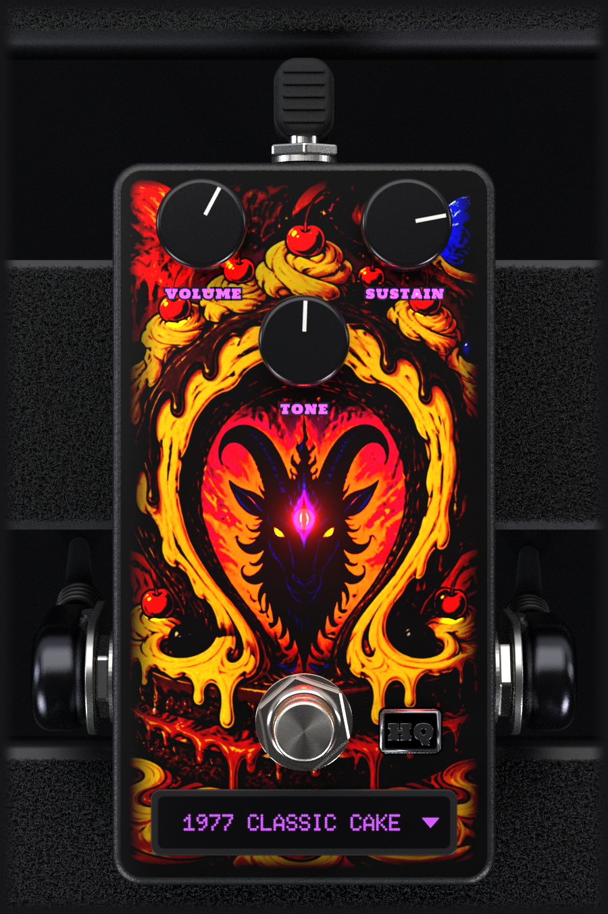

# The Omega Cake

<p align="center"></p>

The Omega Cake is a **fuzz** for guitar that runs on Linux as a mono **LV2** plugin, with its own rendered
interface. It is the four-stage transistor fuzz of 1969 and the family that grew out of it — **45 circuits**, from
the first boards to the op-amp versions, the clones, the mods and a production circuit of 2025 — each one modelled
from its schematic rather than fitted to a curve or captured from a unit. Every model is solved from its components
and checked against a circuit simulator.

This is an independent product and is **not affiliated with, endorsed by, or connected to any pedal manufacturer**.
The model names describe the circuits, not brands.

---

> **Full disclosure: This plugin was vibe-coded.**
>
> The Omega Cake was developed by a musician/audio engineer ([NiLace](https://github.com/NiLace)) directing [Claude](https://claude.ai) (Anthropic's AI) through natural language conversation. The author described what the plugin should do, how it should sound, and how it should look. Claude wrote the C++ code, the DSP algorithms, the UI rendering, the build system, and this README.
>
> The author is not a professional programmer, though he can read C++. Every line of code in this project was generated by AI, then tested and validated by the author in real-world audio production with [Ardour](https://ardour.org) on Linux.
>
> If AI-generated code is a concern for you, this is your notice. The plugin works and it sounds good — but you should know how it was made.

---

## What it is

In 1969 an American effects maker put four transistors in a box: an input booster, two gain stages that clip
through pairs of diodes, a passive tone stack, and a recovery stage to bring the level back up. The result was a
fuzz unlike the ones before it — thick, smooth and long, with a sustain that keeps a held note singing, and a tone
control that scoops the middle out at one end and opens the treble at the other.

It was never one circuit. Over the next decade the boards were revised again and again: different transistors,
different capacitors, a stage with no clipping diodes, a noise gate, and at the end of the 1970s a version built
around op-amps. Russian factories built their own in the 1990s, the maker reissued it in 2000 and kept revising it,
and a whole family of clones and mods grew around it, down to an op-amp circuit that went into production in December
2025. Players look for particular years and particular boards because they sound different.

The Omega Cake collects that family. Each of the **45 models** is one of those circuits, with the component values of
its own board.

## How it is modelled

- **Each model is its circuit.** The transistors, diodes and op-amps are solved together, sample by sample, with the
  values of its schematic and a device model for each transistor, diode and op-amp — the classic stages, the noise
  gate of the biggest one, the op-amps of the late versions — and checked against a **circuit simulator** running the
  same schematic.
- **The knobs are the pots.** Sustain, Tone and Volume turn the potentiometers inside the simulated circuit, through
  each model's own taper, so they interact the way the hardware's do: the tone stack loads the stage in front of it,
  the sustain pot sets how hard the second stage is driven.
- **The switches the circuits had** are there too, on the models that had them, and act only on those models.
- The models were scored against their circuits over the travel of the knobs and at input levels up to a booster in
  front — not with a listening test.

The circuits run at **2× internally** (4× for the op-amp models, and for every model with HQ, see below), so the
harmonics the clipping creates do not fold back into the audible band. That costs **31 samples** of latency at any
session rate (0.65 ms at 48 kHz), the same on every model and with HQ on or off; the plugin reports it and the host
compensates.

## The front panel

Three knobs and a footswitch, like the pedal:

- **Sustain** — how hard the signal is pushed into the clipping stages: the further up, the more fuzz and the longer
  a note holds.
- **Tone** — the classic scooped tone stack: towards one end the bass, towards the other the treble, with the middle
  hollowed out in between. Clockwise is brighter on every model but one, the Dreamy Cake, whose circuit wires the pot the other way.
- **Volume** — the output level.
- The **footswitch** is the bypass. It is wired to the host's standard *enabled* control, so the host understands
  it as a bypass and can automate it. Engaged, the labels light up in purple, the artwork comes alive and the goat's
  third eye glows; bypassed, the print dims and the display goes dark.

Drag a knob up or down to set it, or use the mouse wheel. At the bottom is the **model display**: click it to choose
one of the 45 models, grouped by era; the wheel steps through them. The panel shows only the controls the selected
model has — three knobs; three knobs and a toggle; or a single Volume knob and a toggle for the two models that had
no other control.

The bypass leaves the dry signal **delayed by the same 31 samples** the plugin reports, so mixing it in parallel with
a dry path stays aligned instead of eating a comb filter, and it crossfades over about 10 ms rather than switching
hard. While bypassed, the circuit stops — no CPU — and keeps its state; on re-engage it first settles for 10 ms on
what you are playing before it fades in.

### The switches, and our mods

The toggle above the footswitch is the circuit's own switch, on the models that had one. Everything else below is
**ours** — options the hardware units do not have — and each one says which position sounds like the stock pedal:

| Control | What it does | Stock pedal |
|---|---|---|
| **Tone Bypass** · TONE / BYPASS | The switch of four of the late circuits (Raw Cake, Reversed Cake, Pumpkin Cake, Guru Cake): takes the tone stack out, so the fuzz reaches the volume pot flat — louder and with more middle. | it is the pedal's own switch |
| **Tone Switch** · DARK / BRIGHT | The two models without Sustain or Tone knobs (Mini Pumpkin, Little Pumpkin) have a two-way switch at the two ends of their tone network instead. | it is the pedal's own switch |
| **Model** | 45 circuits in one pedal, chosen from the display. | one model per box |
| **HQ** | Runs every model at 4× oversampling, for the hottest signals — a booster in front, very bright settings — at a higher CPU cost. Clickable with the pedal on. | — (both positions model the same stock circuit; off is lighter) |
| **Level matching** | Each model carries a fixed gain after its circuit, so that with Volume at full every model has the same median loudness over its Sustain and Tone travel, and none peaks above −2 dBTP. Switching models does not jump in level. | the originals differ widely in output |

## What it doesn't model

Stated here so it doesn't have to be inferred:

- **The pedals' switching** — the footswitch wiring and the indicator LED of the hardware — is out of scope. The
  bypass is the host's, as described above.
- **The loading of your guitar's pickups.** That happens in the analogue domain before the converter, so no plugin
  can do it. The plugin takes its input as the voltage at the pedal's input jack: a hotter source drives it harder,
  as it does the real circuit, and there is no input trim — set the level earlier in the chain.
- **Stereo.** The originals are mono pedals, and so is this one.

## To do

- **A bass version.** These models are voiced and validated for guitar; a separate plugin for bass is planned.

## Installing it

The easy way — no compiler needed. Grab the prebuilt bundle from the
[**Releases**](https://github.com/NiLace/TheOmegaCake/releases) page and drop it into your personal LV2 folder:

```sh
mkdir -p ~/.lv2
tar -xzf TheOmegaCake-1.0.0-linux-x86_64.tar.gz -C ~/.lv2/
```

That leaves `TheOmegaCake.lv2/` under `~/.lv2/`. Restart your host (or rescan plugins) and it shows up as **The
Omega Cake** — in **Ardour** or any other LV2 host (Carla, Qtractor, Zrythm, REAPER with LV2…). Put it on a **mono**
track. To uninstall, delete the folder. If your host scans a different location, extract there instead (the
system-wide path is usually `/usr/lib/lv2` or `/usr/local/lib/lv2`).

The bundle is a 64-bit x86 build for Linux, for generic x86-64: it carries a second, faster copy of the hot code for
newer CPUs and picks it at run time, so it also runs on CPUs without AVX2. What each control does on each model, the
CPU cost per model and the full model list are in [`docs/USER_GUIDE.md`](docs/USER_GUIDE.md) and
[`docs/MODEL_LIST.md`](docs/MODEL_LIST.md); what changed in each version is listed in [`CHANGELOG.md`](CHANGELOG.md).

## Building from source

Linux (x86-64; needs CMake 3.21+, a C++20 compiler, pkg-config, the LV2 headers, and the
development packages of `cairo`, `cairo-xlib`, `x11` and `freetype2`):

```sh
cmake -B build -DCMAKE_BUILD_TYPE=Release
cmake --build build -j
```

This assembles the bundle in `build/TheOmegaCake.lv2/`; install it by copying the whole folder to `~/.lv2/`, and
restart the host afterwards (hosts cache the plugin binary).

## Third-party components

- **Fonts** (`assets/fonts/`) — Doto and Space Mono, under the SIL Open Font License 1.1 (full texts beside them).
  They stay under the OFL and are not relicensed under the AGPL. They travel inside the bundle because the interface
  draws the model display with them directly rather than through the system's font configuration.
- **Interface images** (`gui/photo/`, `assets/images/`) — renders of our own 3D scene of the pedal, lit with the
  `studio_small_08` HDRI from [Poly Haven](https://polyhaven.com/a/studio_small_08) (CC0). The lettering in the
  renders is set in Holtwood One SC and Doto (both SIL Open Font License 1.1). The front drawing and the rest of the
  interface are covered by this project's licence.

## How this was made, and the license

This plugin was built mainly with **Claude Code** (Anthropic's AI coding agent), working from my direction on the DSP,
the design, and the testing. I can read C++, but I have not reviewed every line by hand — so please treat it
accordingly:

- **No warranty.** It works in my own testing, but it carries no guarantees of any kind.
- **No support.** This is a personal project; I can't promise help, fixes, or answers.
- **Help is welcome.** If you read code, spot bugs, or want to improve it, review and contributions are genuinely
  appreciated — that's a big part of why it's open.

Released under the **GNU Affero General Public License v3.0, that version only** (`AGPL-3.0-only`) — see
[`LICENSE`](LICENSE). You may use it, study it, modify it and sell it; what nobody may do is close it: any
version you distribute, or let others use over a network, has to come with its complete source under this same
licence. The third-party parts listed above keep their own licences. Contributions are welcome — see
[`CONTRIBUTING.md`](CONTRIBUTING.md).

## Author

Made by **NL Sounds** — <https://github.com/NiLace> · nilace@nylarea.com
